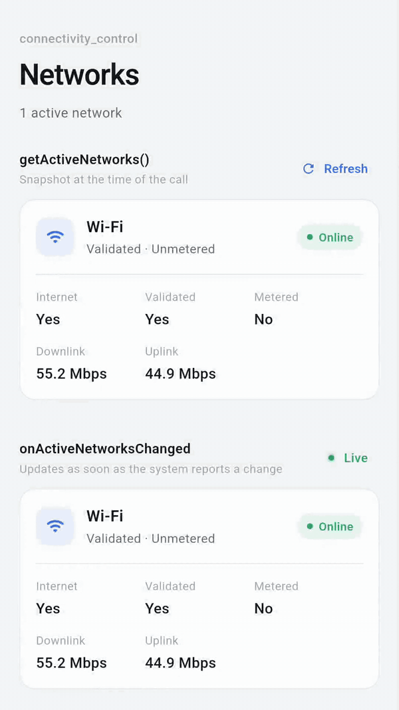
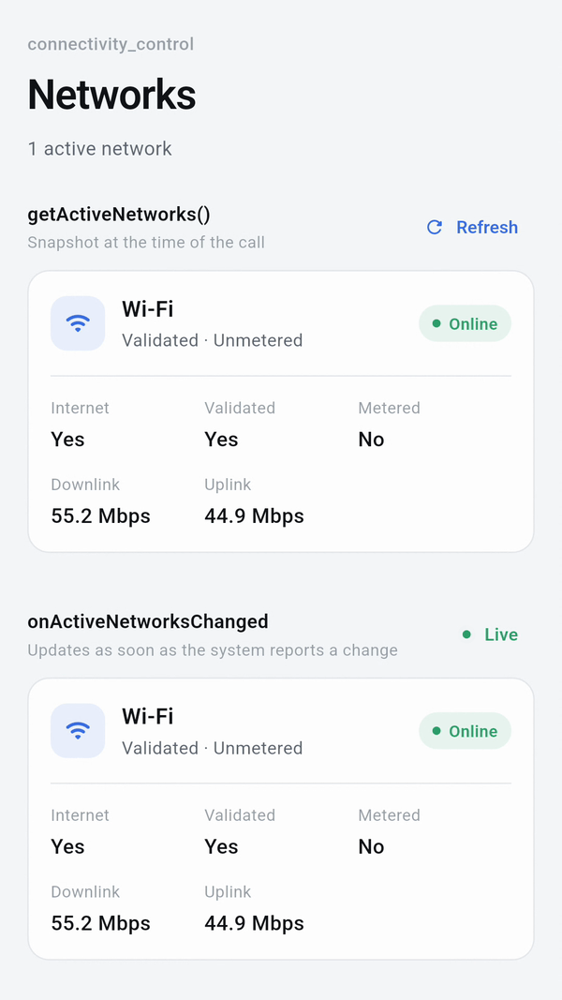
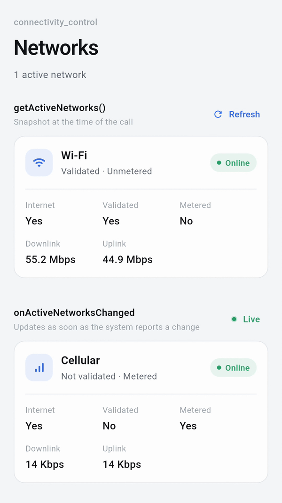
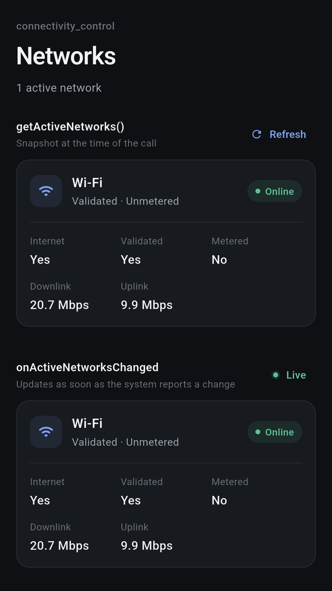

# connectivity_control

A Flutter plugin that provides **low-level, system-driven visibility into active network interfaces** on a device.

Unlike basic connectivity checks, this plugin is designed to help apps **understand, observe, and reason about multiple simultaneous networks** (Wi-Fi, cellular, VPN, etc.) using native platform signals.

<p align="center">
  
</p>

<p align="center"><sub>Turning Wi-Fi off and on. <code>onActiveNetworksChanged</code> updates instantly; <code>getActiveNetworks()</code> updates on refresh.</sub></p>

---

## Features

- Detect **all active network interfaces**
- Identify network **type** (Wi-Fi, cellular, VPN, Ethernet)
- Determine whether a network:
  - Has internet capability
  - Is validated by the system
  - Is metered or unmetered
- Retrieve **upstream and downstream bandwidth estimates** (Android only)
- Listen to **real-time network changes** via streams
- Native, event-driven implementation (no polling)

---

## Screenshots

Captured from the [example app](example/lib/main.dart) on Android.

| Wi-Fi | Wi-Fi switched off | Dark mode |
|:---:|:---:|:---:|
|  |  |  |
| Validated, unmetered, with bandwidth estimates | Live stream moves to Cellular (metered); the snapshot waits for a refresh | Follows the system theme |

---

## Platform Support

| Platform | Support |
|----------|---------|
| Android  | Full support (API 23+) |
| iOS      | Full support (iOS 13+) |
| macOS    | Full support (macOS 10.15+) |

---

## Installation

```yaml
dependencies:
  connectivity_control: ^1.2.0
```

```bash
flutter pub get
```

---

## How to Use

```dart
import 'package:connectivity_control/connectivity_control.dart';
```

### Get Active Networks

```dart
final networks = await ConnectivityControl().getActiveNetworks();
print(networks);
```

### Listen to Network Changes

```dart
ConnectivityControl().onActiveNetworksChanged.listen((networks) {
  print(networks);
});
```

---

## NetworkInfo Fields

| Field | Android | iOS | macOS |
|-------|---------|-----|-------|
| `type` | wifi, cellular, vpn, ethernet | wifi, cellular, ethernet, other | wifi, ethernet, other |
| `hasInternet` | Yes | Yes | Yes |
| `isValidated` | Yes | Yes | Yes |
| `isMetered` | Yes | Yes | Yes |
| `downLinkKbps` | Yes | Not available | Not available |
| `upLinkKbps` | Yes | Not available | Not available |

### Platform Notes

- **VPN detection**: Android reports VPN as a separate network type. iOS and macOS do not expose VPN as a distinct interface type via `NWPathMonitor`; VPN traffic appears under the underlying transport.
- **Bandwidth**: iOS and macOS do not provide bandwidth estimation APIs. `downLinkKbps` and `upLinkKbps` will be `null` on both platforms.
- **`isMetered` on macOS**: Maps to `isExpensive || isConstrained`. `isExpensive` is true for shared connections (e.g. iPhone USB tethering); `isConstrained` reflects the user enabling Low Data Mode in System Preferences.

---

## Comparison with connectivity_plus

[`connectivity_plus`](https://pub.dev/packages/connectivity_plus) is the most widely used connectivity package in the Flutter ecosystem. It answers one question: *what type of connection is the device using?* `connectivity_control` answers a different, lower-level question: *what are the active network interfaces and what do we know about each of them?*

| Feature | `connectivity_control` | `connectivity_plus` |
|---------|----------------------|-------------------|
| Active network type | Yes | Yes |
| Multiple simultaneous networks | Yes — returns all active interfaces | Partial — returns a list but limited per-interface detail |
| Has internet capability | Yes (`hasInternet`) | No — explicitly states it does not guarantee internet access |
| System-validated connection | Yes (`isValidated`) | No |
| Metered / unmetered | Yes (`isMetered`) | No |
| Bandwidth estimates | Yes, Android (`downLinkKbps`, `upLinkKbps`) | No |
| VPN detection | Yes, Android | Yes, but returns `other` on iOS and macOS |
| Bluetooth as connection type | No | Yes (Android, Linux, Web) |
| Satellite as connection type | No | Yes |
| Platform support | Android, iOS, macOS | Android, iOS, macOS, Windows, Linux, Web |
| Real-time stream | Yes | Yes |
| Polling-free | Yes — native event-driven | Yes — native event-driven |

### When to use `connectivity_plus`

- You need broad platform coverage (Windows, Linux, Web)
- You only need to know the general connection type (wifi / cellular / none)
- You need Bluetooth or satellite detection

### When to use `connectivity_control`

- You need to know whether a connection actually has internet access (e.g. captive portal detection)
- You need to distinguish metered from unmetered connections to adapt data usage
- You need bandwidth estimates to adjust media quality
- You need system-validated status to avoid sending requests on unverified connections
- You are building a network-aware feature that needs to reason about multiple simultaneous interfaces
